# Архитектура

## Схема одного запуска

Интерактивная версия со ссылками на строки кода — `architecture-flow.html`; карта для агента — `architecture-map.json`.

```mermaid
flowchart LR
    T[Планировщик Windows<br/>вход + 10 мин, 17:00] --> M[main.py]
    M --> C{Этот выпуск<br/>уже отправлен?}
    C -- да --> X[выход]
    C -- нет --> S

    subgraph S[1. Сбор от закладки]
      TG[Telegram<br/>t.me/s/канал]
      JB[jabka.work<br/>ссылка поиска]
      LI[Письма LinkedIn<br/>IMAP, только чтение]
    end

    S --> E[2. Подборки →<br/>отдельные вакансии]
    E --> P[3. Предфильтр<br/>кодом]
    P --> L[4. Разбор<br/>LM Studio / Qwen → JSON]
    L -. модель недоступна .-> K[ключевые слова]
    L --> B[5. Корзины]
    K --> B
    B --> D[6. Дедуп<br/>внутри запуска + журнал 30 дней]
    D --> H[7. HTML-письмо]
    H --> SMTP[8. SMTP<br/>Gmail / Яндекс]
    SMTP -- принято --> DB[(9. SQLite:<br/>закладки, seen, ledger)]
    SMTP -- ошибка --> F[состояние не трогаем,<br/>следующий запуск повторит]
```



## Модули

| Файл | Отвечает за |
|---|---|
| `main.py` | Оркестрация запуска, флаги `--dry-run`, `--force`, `--no-llm`, `--stats`, логирование |
| `vd/config.py` | Чтение `config.yaml` и `secrets.env` при каждом запуске, пресеты почты |
| `vd/models.py` | `Item` (сырой элемент), `Verdict` (результат разбора), `SourceResult`, `SourceError` |
| `vd/store.py` | SQLite: закладки, просмотренные, журнал отправленного, журнал запусков |
| `vd/sources/telegram.py` | Парсинг `t.me/s/<канал>`, пагинация `?before=`, один пост через `?embed=1` |
| `vd/sources/youngjunior.py` | Выдача youngjunior.ru (`<article>`: должность, формат, зарплата, метка грейда, `<b>` компания, город, «сегодня/вчера/N дней назад»); листание — через `jabka.collect(source=, parse=)` |
| `vd/sources/jabka.py` | Парсинг выдачи jabka.work (ссылки `/jobs/<slug>-YYYYMMDD-<код>`) |
| `vd/sources/career.py` | Общий обход карьерных сайтов: seen, даты первого чтения, фильтр названия перед открытием описания, лимиты страниц и ошибки |
| `vd/sources/habr.py` | Карточки Хабр Карьеры, пагинация по SSR-метаданным, описание без меню |
| `vd/sources/avito.py` | Полный раздел аналитики данных Авито: карточки `/publications/<раздел>/<uuid>/` (с 25.11); описание — открытый API `careers.avito.ru/service-ats-public-api/aviwork/v1/publications/<uuid>` (разделы, формат, статус; даты нет). Уже виденные до смены адресов узнаются по прежнему номеру `vacancies[0].id`; ответ API кешируется на запуск |
| `vd/sources/aviasales.py` | Активные карточки Aviasales и все разделы описания |
| `vd/sources/vk.py` | Публичный API VK с проверкой count/next/offset, HTTPS-пагинация, описание и метатег datePosted |
| `vd/sources/mts.py` | Публичный API каталога МТС: пагинация total/page/offset, ISO publishedAt, бренд и формат; полное HTML-описание |
| `vd/sources/megafon.py` | Серверный каталог МегаФона: __INITIAL_STATE__, page/pages/total, publishedAt, явная метка remote; описание и условия из состояния карточки |
| `vd/sources/sber.py` | Публичный поиск Сбера: skip/take/total; описание Next.js и подтверждённый график workScheduleId=4 |
| `vd/sources/twogis.py` | Публичный каталог 2ГИС: page/pageSize/totalItems/totalPages; описание JobPosting с подтверждением TELECOMMUTE |
| `vd/sources/magnit.py` | Публичный API Magnit Tech: meta.current_page/per_page/total/has_more_pages, полное описание и статус, work_formats; ссылки письма ведут на HTML-карточки |
| `vd/sources/tbank.py` | Читающие POST API getVacancies/getVacancyDescription: offset/limit/totalCount/isFinished; published и точная метка «Удаленный» в tags |
| `vd/sources/alfabank.py` | GET API job.alfabank.ru: skip/take/total, полное описание, jobTypes=1003 «Дистанционная работа»; исключение скрытых, внутренних и истёкших |
| `vd/sources/tochka.py` | Каталог hr.tochka.com/vacancies/it/remote-work/: состояние Next.js `initialVacancies` (total/page/pageSize, без «Показать ещё»); карточка — JobPosting с `jobLocationType=TELECOMMUTE` и datePosted |
| `vd/sources/ostrovok.py` | career.ostrovok.ru/vacancy: `__NEXT_DATA__` (vacancies / vacancy), только approved+actual+OPEN+не hidden; удалёнка — слова «удалёнка/дистанционный» в условиях |
| `vd/sources/getmatch.py` | Открытый API getmatch: meta total/offset/limit, специализации product_analyst + data_analyst_bi; описание — `/api/offers/<id>`; удалёнка — `location_requirements` (remote для России или `_cu-world`, исключение России → нет) |
| `vd/sources/geekjob.py` | JSON-поиск GeekJob `/json/find/vacancy` (`rm=1`, 100 на страницу, page/nextpage/pagecount); карточка — `#vacancy-description`, JobPosting (`identifier` сверяется с id, datePosted); удалёнка — флаг jobFormat.remote и «Удаленная работа» в карточке, архивные исключаются |
| `vd/sources/cdek.py` | Открытый API rabota.cdek.ru/api/vacancies: q, offset/limit, total; удалёнка — тег `remote`; карточка — `main` + JobPosting (identifier сверяется с id) |
| `vd/sources/domclick.py` | Открытый API career.domclick.ru/api/v1/vacancy/ (offset/limit, total не отдаётся — полная страница = запросить следующую); описание `/api/v1/vacancy/detail/<slug>/`; удалёнка — `REMOTE` в work_format, archived исключаются |
| `vd/sources/x5.py` | Открытый API rabota.x5.ru/vacancy/api/v1/public/vacancies (items/page/page_size/total/pages, published_at); описание `…/vacancies/<uuid>` (текстовые поля content); работодатель — бизнес-юнит (X5 Tech, Пятёрочка…); удалёнка — `work_format=remote` |
| `vd/sources/huntflow.py` | Страницы компаний `*.huntflow.io` (сейчас Банки.ру): ссылки `/vacancy/<slug>`, работодатель из заголовка страницы; карточка сверяется по h1; формат только текстом; пустая страница — ошибка |
| `vd/sources/linkedin_mail.py` | Письма LinkedIn по IMAP: вакансии (`/jobs/view/<id>`) и посты знакомых |
| `vd/sources/linkedin_posts.py` | Независимые хэштеги и посты выбранных рекрутеров (`profile_page`, список из `recruiters_file`, отдельный бюджет), нормализация полных постов, несколько вакансий с общими/локальными условиями, метрики тегов и рекрутеров |
| `vd/linkedin_bridge.py`, `vd/linkedin_browser.py` | Локальный IPC с блокировкой и UUID; автозапуск видимого Chrome с отдельным профилем, DOM полного текста и стабильный ID; ручная авторизация |
| `vd/expand.py` | Разворачивание постов-подборок в отдельные вакансии |
| `vd/classify.py` | Предфильтр, запасной разбор по ключевым словам, корзины, дедуп |
| `vd/llm.py` | Клиент LM Studio: автозапуск сервера, JSON-схема ответа, системный промпт |
| `vd/digest.py` | HTML и текстовая версия письма, статистика по источникам |
| `vd/mailer.py` | Отправка письма: на Windows — системный `curl.exe` (smtps, пароль через stdin; Python идёт через VPN, а VPN закрывает почтовые порты), иначе smtplib; «отправлено» только если сервер принял адресата |
| `vd/workcal.py` | Производственный календарь РФ: год с isdayoff.ru → кэш `data/calendar-<год>.txt`; не скачался — «пн–пт» + предупреждение |
| `vd/marks.py` | Отметки «Откликнулся» / «Разобрал группу»: ссылки на Google Форму, разбор CSV таблицы ответов |
| `run_digest.bat`, `setup.bat`, `register_task.ps1` | Запуск, установка, автозапуск в Windows |
| `tests/` | Тесты на образцах реальных страниц и постов; `tests/samples/` — живые страницы, сохранённые при прогонах |

## Контракт источника

Каждый источник — функция `collect(...) -> SourceResult`:

```python
SourceResult(
    source="tg:nodatanojobs",   # уникальное имя источника
    items=[Item, ...],           # только новое относительно закладки
    new_bookmark="672",          # что записать после успешной отправки
    error=None,                  # строка, если источник не прочитан; тогда items пуст, закладка не меняется
)
```

Новый источник = новый модуль в `vd/sources/` + вызов в `main.collect_all` + блок в `config.yaml`.
Источник никогда не бросает исключение наружу — ошибка возвращается в `error` и попадает в письмо.

При `mailer.SendError` запуск остаётся `failed`, закладки и журнал вакансий не продвигаются.
`main._alert_send_failure` делает одну попытку отправить короткое извещение на настроенную почту
с временем запуска, выпуском, причиной и путём HTML. Если SMTP отклоняет и извещение, ошибка
записывается в лог; повторов и рекурсивных уведомлений нет. При полной недоступности SMTP
этот же канал не гарантирует доставку извещения.

Карьерные адаптеры используют общий `career.collect`; дополнительно получают профиль для отсева
неподходящих названий до открытия описания. В `main.collect_all` передаются слот и `dry_run`:
источники с `morning_only: true` вечером пропускаются, кроме проверочного запуска.
В текущем конфиге у всех карьерных сайтов `morning_only: false`: сбор утром и в 17:00.

`SourceResult.seen_ids` содержит идентификаторы старых карточек, исключённых при первом обходе.
`main` сохраняет их в существующую таблицу `seen` вместе с остальным состоянием после доставки письма.
При сбое списка или любого нужного описания адаптер возвращает только ошибку, без элементов и закладки.
Хабр использует `sort=date` и до 20 страниц на запрос; компания берётся из ссылки, без рейтинга.
Aviasales сохраняет команду в названии для различения одноимённых позиций в дедупе.
VK передаёт группу/проект в названии компании (`VK / ВКонтакте`, `VK / ОК`), чтобы одноимённые роли
разных подразделений не сливались. VK и МТС при первом обходе берутся за 14 дней, затем — по `seen`.
Для VK удалёнка подтверждается только точной меткой «Дистанционный» в блоке «Формат работы»
на странице вакансии. Другие метки рядом допустимы; отсутствие этой метки исключает вакансию,
в том числе из `unknown_format`. Поля API `remote`/`work_format` не служат подтверждением.
`Item.remote_format` хранит результат проверки: для VK False до чтения карточки, затем True/False;
для остальных источников None сохраняет разбор по тексту. Проверенный формат применяется и после LLM,
но ограничения РФ и релокации продолжают исключать вакансию.
МегаФон, Сбер и 2ГИС также требуют явного подтверждения удалёнки и обходятся утром и в 17:00.
МегаФон сохраняет метку remote каталога, если описание не содержит поля tag; явное поле tag в описании
перепроверяет формат. Сбер сверяет график самой вакансии с публичным справочником (4 = «Удаленная работа»).
2ГИС сверяет JobPosting.jobLocationType == TELECOMMUTE. Первое чтение — 14 дней при известной дате,
без даты — текущая активная карточка; дата сбора не заменяет дату публикации.
Magnit Tech также проверяется утром и в 17:00. `collect` переводит запрос описания с публичной ссылки
`/vacancies/<id>` на JSON `/api/v1/vacancy/<id>` только для чтения; ссылка в Item не меняется.
Формат подтверждается в полной карточке по work_formats (16108 = Москва/Краснодар гибрид/офис,
другие города удалённо). Архивные/неопубликованные исключаются. В текущем API нет даты публикации,
поэтому первый обход берёт активные карточки, затем новизна по seen.
Т-Банк и Альфа-Банк также включены в оба выпуска. Т-Банк не отдаёт дату публикации;
при первом обходе берутся активные карточки. Внешние переадресации (в том числе стажировки) пропускаются.
Альфа-Банк использует createdAt и первые 14 дней; зашифрованный id в деталях сверяется по
неизменному публичному slug и названию. Подтверждение удалёнки — только структурированное поле
полной карточки, свободный текст его не заменяет. Ограничения РФ/релокации проверяются классификатором.
`main.make_fetcher(url, *, json=None)` сохраняет GET по умолчанию и поддерживает читающие POST
Т-Банка; таймаут, пауза, проверка HTTP-статуса и TLS общие для обоих методов.
В `make_session` для трёх точных HTTPS-origin (`www.tbank.ru`, `job.alfabank.ru`, `hr.tochka.com`) добавлен
официальный Russian Trusted Root CA из `vd/certs/`. Только эти соединения используют SSLContext
с обычными корнями Requests плюс дополнительным CA. Проверка имени хоста и цепочки обязательна;
системное хранилище Windows и certifi не меняются. Для остальных сайтов адаптер стандартный.
Явный CA-файл пользователя/REQUESTS_CA_BUNDLE сохраняет приоритет. Требуется Requests >=2.32.3.

С 18.11 `make_fetcher` ограничен тремя попытками для Timeout/ConnectionError/обрыва тела и
HTTP408/429/500/502/503/504. Паузы1/2с; Retry-After до30с учитывается, более длинный не обходится
ранним повтором. TLS-ошибки и другие4xx не повторяются. Эта политика применяется только к
чтению источников/таблицы отметок, включая читающие POST API; отправка писем её не использует.

Недочитанные подборки хранятся как сериализованные Item в `pending_bundles` (SQLite),
обновляются в `commit_after_send` одной транзакцией с seen/ledger/bookmarks/marks. Заголовок
не заменяет неоткрытый дочерний пост. Вложенные подборки кэшируются отдельно с исходным
каналом в via и наследуемым грейдом; поэтому цепочки продвигаются даже при бюджете1.
Ротация непрочитанных ссылок и очереди не даёт постоянным ранним сбоям блокировать остальные.
Очередь отключённых каналов сохраняется без сетевых запросов; dry-run/ошибка SMTP её не меняют.

Ключ ledger теперь включает нормализованный URL: tracking-параметры/fragment удаляются,
идентифицирующие query-параметры сохраняются. Старые строки/коды отметок не переписываются.
Межисточниковое сопоставление использует нормализованные название+компанию (набор слов, см. «Дедуп») либо URL;
разные URL одного site-источника сохраняются как отдельные позиции. Fuzzy-порог0.8 убран.
Гибрид с обязательными офисными днями («4 офисных дня», «3 дня в офисе», «офис 2 дня в неделю») при разборе
текста — не удалёнка (`classify.HYBRID_DAYS`), кроме выбора «удалёнка или гибрид» и офиса «по желанию»
(`REMOTE_CHOICE`); структурированный формат источника (`remote_format`) по-прежнему главнее текста.
Код отсекает отрицания удалёнки и явные ограничения резидентства поверх меток и LLM;
неизвестная явно ограниченная территория даёт unknown. Островок использует тот же разбор условий.
У них читается публичная JSON-выдача с пагинацией и только подходящие по названию HTML-описания.
Противоречивые метаданные страниц возвращаются как ошибка без состояния. `career.add_detail` сохраняет
ссылки из списка и добавляет ссылки описания, чтобы исходная ссылка на hh.ru продолжала отсекаться.
Хабр различает пустую выдачу и поломанную вёрстку по SSR-метаданным; неизвестная пустая страница
Авито/Aviasales считается сбоем. Лимит страниц и повтор страницы сопровождаются предупреждением.

## Закладки по источникам

| Источник | Закладка | Новизна |
|---|---|---|
| Telegram | id последнего прочитанного поста | посты с id > закладки; первый запуск — за `lookback_days_first_run` |
| jabka.work | время последнего чтения (маркер «уже читали») | таблица `seen`; первый запуск — карточки за N дней |
| Хабр Карьера, Авито, Aviasales, VK, МТС, МегаФон, Сбер, 2ГИС, getmatch, GeekJob | время последнего чтения (маркер «уже читали») | `seen`; первый запуск — lookback_days_first_run (5 / 14 дней) при известной дате, иначе активные вакансии; старые исключённые id тоже запоминаются |
| LinkedIn | UID последнего письма в IMAP | письма с UID > закладки |
| Подборки | — | ссылка на пост пропускается, если пост есть в `seen` или в текущем запуске |

## Хранилище `data/state.sqlite`

```sql
bookmarks(source PK, value, updated_at)              -- закладки
seen(source, external_id, first_seen, PK(source, external_id))  -- что уже разобрано
ledger(dedup_key PK, title, company, url, source, bucket, reported_at, status, code)  -- что ушло в письма
runs(id, run_date, started_at, finished_at, status, stats_json, error)          -- журнал запусков
```

`status` в `runs`: `running` / `sent` / `empty` / `failed` / `dry-run`.
`ledger.code` — код вакансии в письме `vd-ГГГГММДД-am|pm-N` (выпуск до/после 17:00 + номер).
`ledger.status`: `new` → `applied` (отметка «✓ Откликнулся») или `reviewed` («☑ Разобрал группу»);
отмеченные не возвращаются никогда (дедуп сверяет их без ограничения 30 дней). `rejected` / `interview` — под v3.

## Письмо и отметки

Вакансии сгруппированы по источнику (из подборки — в группе канала-подборки), сначала источники с большим
числом подходящих; внутри группы зелёные («удалённо из РФ»), потом оранжевые («формат не указан»).
Сквозные номера. Под вакансией — «✓ Откликнулся», под группой — «☑ Разобрал группу (N)».

Ссылки ведут на `formResponse` Google Формы (`config.yaml → marks`): один клик пишет в таблицу ответов
строку `код · название · компания` или `vd-…-1,2,5 · Разобрано · источник: 1. …; 2. …` (длинный список
сокращается до «и ещё N», ссылка < 5000 символов). Каждый запуск читает CSV-выгрузку таблицы (доступ по
ссылке на просмотр): новые отметки — зелёная строка вверху письма; статус пишется в `commit_after_send`,
т.е. только после отправки. Таблица не открылась → красная плашка «Отметки откликов», остальное работает.
Письмо статично: в самом письме отметку не видно (`:visited` Яндекс не применяет — проверено 20.10).

Запись `bookmarks + seen + ledger` — одна транзакция `Store.commit_after_send()`, только после успешного SMTP.

## Отбор

**Предфильтр (код, до модели):** пустые посты; ссылка на hh.ru / headhunter.ru («там откликаюсь сам»); нет слов «аналитик / analyst / analytics»;
старые подборки-дубли; для постов LinkedIn — нет признаков найма.

**Разбор (LLM):** LM Studio, OpenAI-совместимый `/v1/chat/completions`, `temperature=0`,
`response_format=json_schema`. Поля: `is_vacancy, title, company, role, grade, remote_from_russia,
salary, contact, reason`. Блоки `<think>` вырезаются (Qwen3). Если сервер не отвечает — один раз
`lms server start`; если модель не загружена — `lms load`. После первого отказа модели весь
остаток запуска идёт по ключевым словам, в письме — жёлтая плашка.

**Проверка ответа модели (`classify.guard_llm`):** `remote_from_russia = no` при тексте без единого слова
о формате (офис, гибрид, удалёнка, «кроме РФ»…) → `unknown`: модель путает «не подходит» с «не удалённо».
Контакт оставляем, только если это @ник, почта или ссылка.

**Корзины (`classify.decide`):**

| Корзина | Условие |
|---|---|
| `network` | пост знакомого из LinkedIn, не «точно не удалённо» |
| `main` | целевая роль, грейд не junior/intern, `remote_from_russia = yes` |
| `unknown_format` | то же, но формат не указан |
| `drop` | всё остальное, с причиной (`drop_reason`) — причины сводкой внизу письма |

«Целевая роль» = должность проходит `profile.title_queries` (`classify.title_match`) — запросы в духе hh.ru
`NAME:(include…) AND NOT NAME:(exclude…)`: подходит хотя бы под один запрос; проверяется только часть
названия до « — » (на jabka после тире описание); include — целым словом («аналитик» не ловит
«для аналитики»), exclude — по началу слова («системный» ловит «системного»).
Причина отсева — «стоп-слово в должности: <слово>» или «должность не подходит под запрос».
Без `title_queries` — запасной отбор по `target_roles`. Требование SQL / Python / Excel снято 20.10.

**Дедуп:** `vd/duplicates.py` готовит пакет архива и применяет текущий точный дедуп из `vd/classify.py`.
Ключ ledger остаётся `норм(компания)|норм(должность)|канонический URL`; только несколько разных
вакансий в одном посте получают суффикс `part`, чтобы иметь отдельные коды и отметки.
Подтверждение исходной вакансии — конкретная ссылка/ID в пространстве сайта работодателя;
страницы списков, пагинации, общие формы и контакты не подходят. Между источниками одна вакансия —
одна известная компания и одинаковый набор слов должности без названия компании (`classify._similar`:
«Data Analyst / Product Analyst в Grand Mobile» = «Data / Product Analyst Grand Mobile»); если компания
известна только у одной публикации, она должна быть названа в должности другой. Разные грейды блокируют
это правило; разные ID блокируют его только в пределах одного сайта (`_same_site_ids`, с 25.11).
При объединении учитываются идентификаторы всей группы, чтобы публикация без ID не связывала разные позиции.
Представитель выбирается предсказуемо: прямая карточка работодателя, затем наиболее полная публикация.
Ссылки на остальные публикации есть в HTML и текстовой версии.

Новые таблицы: `vacancy_entities`, `publications` (полный и исходный тексты, ссылки, работодатель,
направление команды из заголовка, грейд, даты), `vacancy_deliveries` (история кодов/статусов),
`duplicate_suggestions` (пара, объяснение, версия). Добавляются без переписывания старого ledger.
Архивируются и подавленные точные дубли. Запись атомарна с seen/bookmarks/ledger после отправки
или успешного пустого выпуска; dry-run и SMTP failure не пишут архив. Старые коды после повторной
отправки остаются доступны для отметок через историю отправок.

Сверка точных дублей — внутри запуска и за `dedup_days` (30 дней); applied/reviewed — без срока.
Для смысловых предположений: одинаковые известные компания и направление в заголовке, отсутствие
разных ID/грейдов, минимум 12 общих содержательных слов, пересечение >= 0.5 от меньшего набора слов.
Шаблон условий исключается. Окно — 10 дней от первого наблюдения, повтор не продлевает его.
Предположения только помечаются, не объединяют сущности и не переносят отметки.
`runs.stats_json.duplicates` содержит confirmed/possible, версию, режим suggest-only и флаг observation.
Счётчик наблюдения учитывает sent/empty без --force, сбоев и предупреждений, минимум шесть выпусков;
автоматического изменения режима нет. Массовой дозагрузки старых описаний нет.

## Подборки (`vd/expand.py`)

Подборка = пост Telegram, где ≥ 2 ссылок с текстом-должностью (или ≥ 1, если пост начинается с «Подборка») (служебные ссылки, хештеги
`t.me/s/…?q=` и боты `?start=` игнорируются) **или** ≥ 2 цитат со ссылкой (`Item.blocks`, формат mtsbankcareer:
цитата = название, описание, «Москва | Офис или гибрид», «Откликнуться»).
- цитата с «аналитик / analyst» в первой строке → элемент `digest_link` с текстом **только этой цитаты**
  (формат работы проверяется по самой вакансии); остальные цитаты (дизайнер, бренд-менеджер) пропускаются;
- ссылка на пост Telegram: видели → пропуск; не видели → открыть пост целиком (`t.me/<канал>/<id>?embed=1`),
  не открылся → очередь повторного чтения, без фиктивной title-only вакансии; открытый пост сам оказался подборкой
  (например, «Подборка вакансий в Авито» внутри недельной) → разворачивается так же;
- внешняя ссылка → элемент `digest_link`: название из ссылки + условия из самого поста-подборки.
Грейд вакансии из подборки (`Item.grade_hint`, `expand.section_grade`) — ближайший заголовок раздела над её строкой
(«Junior:», «Стажёр:», «Middle:»), иначе заголовок подборки («Подборка Junior/Стажёр удалённо»); junior/intern →
отсев «грейд: junior (подборка)», и копия той же вакансии из другого канала в этом же выпуске — тоже (`dedup`).
Строка-меню канала («Вакансии │ Стажировки │ … │ Удалёнка │ …», ≥ 3 «│») из текста поста убирается — иначе «Удалёнка» = удалёнка.
Лимит открытий за запуск — `max_digest_fetches`. В статистике вакансия засчитывается каналу с подборкой.

## Отказоустойчивость

| Сбой | Поведение |
|---|---|
| Источник не ответил / пустая страница / сменилась вёрстка | красная плашка с причиной понятным языком (`digest.explain_error`: блокировка, DNS, таймаут, код ответа), закладка стоит; не прочитан ни один канал Telegram — одна строка «нужен VPN» |
| LM Studio недоступна | отбор по ключевым словам, жёлтая плашка |
| Письмо не ушло | состояние не меняется, запуск `failed`, следующий вход в Windows повторит |
| Нет `config.yaml` | остановка с ошибкой в логе |
| Запуск упал (необработанное исключение) | запуск → `failed` (`Store.fail_running`), письмо «СБОЙ агента» с трассировкой; состояние не меняется |
| Канал: новых постов больше `max_pages_per_run` | `SourceResult.warning` → жёлтая плашка; закладка перепрыгивает, остаток пропущен |
| Повторный запуск в тот же выпуск (утро — до `run.evening_hour`, вечер — после) | выход без письма (`--force` — принудительно) |
| Нерабочий день (выходной, праздник, перенос) | выход до начала запуска: ничего не собираем и не пишем; `--force` / `--dry-run` работают |
| isdayoff.ru недоступен | правило «пн–пт», красная плашка «Производственный календарь»; плохой ответ не кэшируется |
| Компьютер выключен в 17:00 | Планировщик запустит при включении (`StartWhenAvailable`); выпуск — по текущему времени |

## Конфигурация

- `config.yaml` — источники, профиль и запросы по названию, почта, отметки, LLM, расписание выпусков. Агент только читает.
- `secrets.env` — адрес и пароль приложения почты. **В git не попадает** (`.gitignore`).
- `config.yaml → marks` — ссылки на Google Форму отметок и CSV её таблицы (не секрет).
- Логи: `logs/run.log` (ротация 1 МБ × 3), `logs/scheduler.log`. Письма для просмотра: `out/digest_<дата>-am|pm.html`.

## Куда расти

- v2: модуль `vd/cover_letter.py` — черновики сопроводительных для топ-N вакансий (Claude API, мой промт, `cases*.md`).
- v3: Telegram-бот с кнопкой «откликнуться», обновление `ledger.status`.
- Hirify через официальный API как источник с готовой разметкой.

## Changelog

Свежее — снизу. Подробности и «почему» — в журнале `memory.md`.

| Дата | Коммит | Что изменилось в устройстве |
|---|---|---|
| 2026-10-19 | 126a6e1 | v1: Telegram (`t.me/s`), jabka.work, LinkedIn-почта (выключено), подборки, LLM + запасной отбор, дедуп, письмо, SQLite, автозапуск |
| 2026-10-19 | f964330 | Telegram: строки поста только по `<br>`; подборка внутри подборки; `classify.guard_llm` — проверка ответа модели кодом |
| 2026-10-20 | 85d929a | Отбор по названию — `profile.title_queries` (запросы в стиле hh.ru, должность до « — »); модель выключена; снято требование SQL/Python/Excel |
| 2026-10-20 | 6742212 | Канал mtsbankcareer и подборки-цитаты (`Item.blocks`); листание jabka `&page=N`; «новых постов нет / подходящих не найдено» |
| 2026-10-20 | 1418c2c | Отметки «Откликнулся» / «Разобрал группу» через Google Форму (`vd/marks.py`, `ledger.code`, статусы applied/reviewed); письмо сгруппировано по источникам |
| 2026-10-20 | 430ea2e | Два выпуска в день — утро и вечер с 17:00 (`Store.sent_in_slot`); задача Планировщика: вход + 3 мин и 17:00 |
| 2026-10-21 | — | Changelog в ARCHITECTURE.md; README догнан до текущего состояния; CLAUDE.md: «гит сейв / гит лоад» и правила работы из project-starter (Карпатый, Superpowers); `.claude/settings.json` (разрешён прогон тестов); pyright-lsp; схема `architecture-flow.html` (Archify) и карта `architecture-map.html/.json` в корне |
| 2026-10-21 | — | Ревью кода: дедуп без компании — только по ссылке; компания jabka из «@ \| Компания»; письмо «СБОЙ» и `fail_running`; повторно присланная вакансия получает новый код (upsert); `--force` в тот же выпуск — коды `am2…`; `--stats` с откликами; предупреждение о лимите страниц Telegram |
| 2026-10-21 | — | Письма только в рабочие дни: `vd/workcal.py` (isdayoff.ru + кэш), `run.workdays_only`; лимит листания jabka 20 страниц (`max_pages`) |
| 2026-10-22 | — | Каналы young_june, newdirections, bigtechjobs; отсев ссылок на hh.ru; грейд из разделов подборки + junior-двойники в других каналах; меню канала «│» убирается из текста; подборка «Подборка…» с одной ссылкой разворачивается |
| 2026-10-22 | — | Источник youngjunior.ru (`vd/sources/youngjunior.py`; `jabka.collect` принимает `source`/`parse`); сайты в `main.collect_all` — таблица имя → collector |
| 2026-10-26 | — | Причина сбоя источника понятным языком (`digest.explain_error`), все каналы Telegram разом — одной строкой «нужен VPN»; исправлены невидимые символы вместо «\b» в `expand.GRADE_WORDS` («Lead:»); `tools/build_map.py` — сборка карты в проекте |
| 2026-10-26 | — | `vd/mailer.py`: отправка через системный curl.exe (Python идёт через VPN Browsec, а VPN закрывает почтовые порты); smtplib — запасной путь без curl |
| 2026-10-26 | — | Задержка утреннего запуска после входа — 10 минут (успевает подключиться Browsec VPN) |
| 2026-11-12 | — | Хабр Карьера, Авито и Aviasales через `career.collect`; утренний режим `morning_only`, dry-run в любое время; `SourceResult.seen_ids` для исключённых старых карточек первого обхода, без изменения схемы SQLite |
| 2026-11-12 | — | Релокация проверяется до удалёнки; «без релокации» и «релокация не требуется» не отсекаются |
| 2026-11-12 | — | `digest._meta`: дата из `Item.published_at` в HTML и текстовой версии каждой карточки; aware datetime в МСК, без даты — явная подпись, для digest_link — дата подборки |
| 2026-11-12 | — | VK и МТС: два утренних адаптера публичных API, полная пагинация и описания; `career.add_detail` сохраняет исходные ссылки. Без новых зависимостей, ключей или схемы БД |
| 2026-11-16 | — | Файл MIME для curl сериализуется с SMTP policy (CRLF); порт 465 сохранён. Регрессионный тест формата; влияние на реальный SMTP-таймаут ещё требует проверки |
| 2026-11-16 | — | Сравнение на Яндексе: LF — таймаут после DATA/354, CRLF — финальный 250 на том же порту 465. Подробности в docs/smtp-timeout-2026-11-16.md |
| 2026-11-16 | — | main._alert_send_failure: одна попытка отдельного почтового извещения при mailer.SendError; сбой извещения только логируется, история не продвигается |
| 2026-11-16 | — | VK: обязательная метка «Дистанционный» в HTML-поле «Формат работы»; Item.remote_format передаёт подтверждённый формат в классификатор, отсутствие метки исключает вакансию |
| 2026-11-16 | — | МегаФон, Сбер и 2ГИС: три утренних адаптера с пагинацией, проверкой описаний и явной удалёнки, первый обход14 дней; source names и расписание, без изменения SQLite-схемы |
| 2026-11-18 | — | Точка Банк и Островок: два адаптера (`tochka.py`, `ostrovok.py`), утро и вечер; `hr.tochka.com` добавлен в точные origin с дополнительным CA; без изменения схемы SQLite |
| 2026-11-16 | — | Магнит Tech: публичный каталог и API описаний, пагинация, статус и удалённый формат из полной карточки; утро, без изменения SQLite-схемы |
| 2026-11-20 | — | LinkedIn: Escape перед повторным открытием меню устраняет гонку toggle; причина ошибки копирования сохраняется. IPC повторяет чтение при временном PermissionError Windows в пределах прежнего deadline. Две регрессии, 293 теста OK; бюджет и лимиты не менялись |
| 2026-11-20 | — | LinkedIn: total_timeout_by_date задаёт бюджет на конкретную дату, иначе total_timeout_sec. На 23.11 — 1200 с для 14 тегов, остальные даты — прежние 360 с; регрессия до/в/после даты, 294 теста OK |
| 2026-11-23 | — | LinkedIn: лимиты на тег подняты до 20 карточек и 2 прокруток (потолок кода — 20 и 3), общий бюджет total_timeout_sec 360→1000 с. Жёлтая плашка «частичная выдача» появляется при каждом упоре в лимит, это штатное поведение. Изменён только config.yaml, 294 теста OK, живой прогон не выполнялся |
| 2026-11-25 | — | getmatch и GeekJob: два адаптера через `career.collect` (`getmatch.py` — открытый API и структурированный формат работы; `geekjob.py` — JSON-поиск с фильтром удалёнки и HTML-карточка с JobPosting), утро и вечер; без новых зависимостей и без изменения схемы SQLite. 316 тестов OK |
| 2026-11-25 | — | LinkedIn: посты 42 выбранных рекрутеров — команда контроллера `scan_profile` («Все действия» человека / «Публикации» компании, дата до копирования ссылки, остановка на старом посте у человека), `relative_date` понимает месяцы и годы, список в локальном `data/linkedin-recruiters.yaml` (`recruiters_file`), бюджет 420 с отдельно от хэштегов, сводная строка в письме и `stats.recruiters`. живая проверка 4 профилей на Windows пройдена; занятый буфер обмена повторяется до 10 раз через 0,1 с (`_open_clipboard`). 330 тестов OK |
| 2026-11-25 | — | Без изменений кода: `docs/constitution.md` (незыблемые правила, ссылка в CLAUDE.md), карта `architecture-map.json/.html` обновлена до a361540, аудит безопасности ветки без находок; Graphify/Codex-файлы в `.gitignore` |
| 2026-11-25 | — | СДЭК, Домклик и Huntflow (Банки.ру): три адаптера через `career.collect`, утро и вечер; `classify.remote_of`: гибрид с обязательными офисными днями — не удалёнка (кроме выбора «удалёнка или гибрид»). 344 теста OK |
| 2026-11-25 | — | Дедуп между источниками усилен: `_similar` сравнивает набор слов должности без названия компании и допускает компанию только у одной публикации, если она названа в должности другой; `_same_site_ids` — разные ID блокируют склейку только внутри одного сайта. На истории с 01.11 — 6 настоящих пропущенных дублей, ложных склеек нет. 349 тестов OK |
| 2026-11-26 | — | Авито: переход на `/publications/…` и API публикаций careers.avito.ru, распознавание уже виденных по прежнему номеру; X5: новый адаптер `x5.py` (открытый API, `work_format`). Positive Technologies не подключён (9 вакансий, 0 удалённых). 356 тестов OK |
