# Архитектура

## Схема одного запуска

```mermaid
flowchart LR
    T[Планировщик Windows<br/>вход + 3 мин] --> M[main.py]
    M --> C{Сегодня<br/>уже отправлено?}
    C -- да --> X[выход]
    C -- нет --> S

    subgraph S[1. Сбор от закладки]
      TG[Telegram<br/>t.me/s/канал]
      JB[jabka.work<br/>ссылка поиска]
      LI[Письма LinkedIn<br/>IMAP, только чтение]
    end

    S --> E[2. Подборки →<br/>отдельные вакансии]
    E --> P[3. Предфильтр<br/>кодом]
    P --> L[4. Разбор<br/>LM Studio / Qwen → JSON]
    L -. модель недоступна .-> K[ключевые слова]
    L --> B[5. Корзины]
    K --> B
    B --> D[6. Дедуп<br/>внутри запуска + журнал 30 дней]
    D --> H[7. HTML-письмо]
    H --> SMTP[8. SMTP<br/>Gmail / Яндекс]
    SMTP -- принято --> DB[(9. SQLite:<br/>закладки, seen, ledger)]
    SMTP -- ошибка --> F[состояние не трогаем,<br/>следующий запуск повторит]
```



## Модули

| Файл | Отвечает за |
|---|---|
| `main.py` | Оркестрация запуска, флаги `--dry-run`, `--force`, `--no-llm`, `--stats`, логирование |
| `vd/config.py` | Чтение `config.yaml` и `secrets.env` при каждом запуске, пресеты почты |
| `vd/models.py` | `Item` (сырой элемент), `Verdict` (результат разбора), `SourceResult`, `SourceError` |
| `vd/store.py` | SQLite: закладки, просмотренные, журнал отправленного, журнал запусков |
| `vd/sources/telegram.py` | Парсинг `t.me/s/<канал>`, пагинация `?before=`, один пост через `?embed=1` |
| `vd/sources/jabka.py` | Парсинг выдачи jabka.work (ссылки `/jobs/<slug>-YYYYMMDD-<код>`) |
| `vd/sources/linkedin_mail.py` | Письма LinkedIn по IMAP: вакансии (`/jobs/view/<id>`) и посты знакомых |
| `vd/expand.py` | Разворачивание постов-подборок в отдельные вакансии |
| `vd/classify.py` | Предфильтр, запасной разбор по ключевым словам, корзины, дедуп |
| `vd/llm.py` | Клиент LM Studio: автозапуск сервера, JSON-схема ответа, системный промпт |
| `vd/digest.py` | HTML и текстовая версия письма, статистика по источникам |
| `vd/mailer.py` | Отправка по SMTP, «отправлено» только если сервер принял адресата |
| `run_digest.bat`, `setup.bat`, `register_task.ps1` | Запуск, установка, автозапуск в Windows |
| `tests/` | Тесты на образцах реальных страниц и постов |

## Контракт источника

Каждый источник — функция `collect(...) -> SourceResult`:

```python
SourceResult(
    source="tg:nodatanojobs",   # уникальное имя источника
    items=[Item, ...],           # только новое относительно закладки
    new_bookmark="672",          # что записать после успешной отправки
    error=None,                  # строка, если источник не прочитан; тогда items пуст, закладка не меняется
)
```

Новый источник = новый модуль в `vd/sources/` + вызов в `main.collect_all` + блок в `config.yaml`.
Источник никогда не бросает исключение наружу — ошибка возвращается в `error` и попадает в письмо.

## Закладки по источникам

| Источник | Закладка | Новизна |
|---|---|---|
| Telegram | id последнего прочитанного поста | посты с id > закладки; первый запуск — за `lookback_days_first_run` |
| jabka.work | время последнего чтения (маркер «уже читали») | таблица `seen`; первый запуск — карточки за N дней |
| LinkedIn | UID последнего письма в IMAP | письма с UID > закладки |
| Подборки | — | ссылка на пост пропускается, если пост есть в `seen` или в текущем запуске |

## Хранилище `data/state.sqlite`

```sql
bookmarks(source PK, value, updated_at)              -- закладки
seen(source, external_id, first_seen, PK(source, external_id))  -- что уже разобрано
ledger(dedup_key PK, title, company, url, source, bucket, reported_at, status)  -- что ушло в письма
runs(id, run_date, started_at, finished_at, status, stats_json, error)          -- журнал запусков
```

`status` в `runs`: `running` / `sent` / `empty` / `failed` / `dry-run`.
`ledger.status` (`new` / `applied` / `rejected` / `interview`) зарезервирован под v3 и анализ откликов.

Запись `bookmarks + seen + ledger` — одна транзакция `Store.commit_after_send()`, только после успешного SMTP.

## Отбор

**Предфильтр (код, до модели):** пустые посты; нет слов «аналитик / analyst / analytics»;
старые подборки-дубли; для постов LinkedIn — нет признаков найма.

**Разбор (LLM):** LM Studio, OpenAI-совместимый `/v1/chat/completions`, `temperature=0`,
`response_format=json_schema`. Поля: `is_vacancy, title, company, role, grade, remote_from_russia,
salary, contact, reason`. Блоки `<think>` вырезаются (Qwen3). Если сервер не отвечает — один раз
`lms server start`; если модель не загружена — `lms load`. После первого отказа модели весь
остаток запуска идёт по ключевым словам, в письме — жёлтая плашка.

**Корзины (`classify.decide`):**

| Корзина | Условие |
|---|---|
| `network` | пост знакомого из LinkedIn, не «точно не удалённо» |
| `main` | целевая роль, грейд не junior/intern, `remote_from_russia = yes` |
| `unknown_format` | то же, но формат не указан |
| `drop` | всё остальное, с причиной (`drop_reason`) — причины сводкой внизу письма |

Для аналитика данных обязателен SQL / Python / Excel в тексте — кроме вакансий из подборок,
где есть только название.

**Дедуп:** ключ `норм(компания)|норм(должность)` + нечёткое сравнение (`SequenceMatcher`):
при совпадении компаний порог 0.8, если компания известна у одной стороны — 0.9, иначе 0.95.
Сверяется внутри запуска (дубль из другого канала → подпись «также: …») и с журналом за `dedup_days`.

## Подборки (`vd/expand.py`)

Подборка = пост Telegram, где ≥ 2 ссылок с текстом-должностью (служебные ссылки, хештеги
`t.me/s/…?q=` и боты `?start=` игнорируются).
- ссылка на пост Telegram: видели → пропуск; не видели → открыть пост целиком (`t.me/<канал>/<id>?embed=1`),
  не открылся → вакансия с названием из ссылки;
- внешняя ссылка → элемент `digest_link`: название из ссылки + условия из самого поста-подборки.
Лимит открытий за запуск — `max_digest_fetches`. В статистике вакансия засчитывается каналу с подборкой.

## Отказоустойчивость

| Сбой | Поведение |
|---|---|
| Источник не ответил / пустая страница / сменилась вёрстка | красная плашка, закладка стоит, остальные источники работают |
| LM Studio недоступна | отбор по ключевым словам, жёлтая плашка |
| Письмо не ушло | состояние не меняется, запуск `failed`, следующий вход в Windows повторит |
| Нет `config.yaml` | остановка с ошибкой в логе |
| Повторный вход в тот же день | выход без письма (`--force` — принудительно) |

## Конфигурация

- `config.yaml` — источники, профиль, почтовый провайдер, LLM. Агент только читает.
- `secrets.env` — адрес и пароль приложения почты. **В git не попадает** (`.gitignore`).
- Логи: `logs/run.log` (ротация 1 МБ × 3), `logs/scheduler.log`. Письма для просмотра: `out/digest_<дата>.html`.

## Куда расти

- v2: модуль `vd/cover_letter.py` — черновики сопроводительных для топ-N вакансий (Claude API, мой промт, `cases*.md`).
- v3: Telegram-бот с кнопкой «откликнуться», обновление `ledger.status`.
- Hirify через официальный API как источник с готовой разметкой.
