# Архитектура

## Схема одного запуска

Интерактивная версия со ссылками на строки кода — `architecture-flow.html`; карта для агента — `architecture-map.json`.

```mermaid
flowchart LR
    T[Планировщик Windows<br/>вход + 3 мин, 17:00] --> M[main.py]
    M --> C{Этот выпуск<br/>уже отправлен?}
    C -- да --> X[выход]
    C -- нет --> S

    subgraph S[1. Сбор от закладки]
      TG[Telegram<br/>t.me/s/канал]
      JB[jabka.work<br/>ссылка поиска]
      LI[Письма LinkedIn<br/>IMAP, только чтение]
    end

    S --> E[2. Подборки →<br/>отдельные вакансии]
    E --> P[3. Предфильтр<br/>кодом]
    P --> L[4. Разбор<br/>LM Studio / Qwen → JSON]
    L -. модель недоступна .-> K[ключевые слова]
    L --> B[5. Корзины]
    K --> B
    B --> D[6. Дедуп<br/>внутри запуска + журнал 30 дней]
    D --> H[7. HTML-письмо]
    H --> SMTP[8. SMTP<br/>Gmail / Яндекс]
    SMTP -- принято --> DB[(9. SQLite:<br/>закладки, seen, ledger)]
    SMTP -- ошибка --> F[состояние не трогаем,<br/>следующий запуск повторит]
```



## Модули

| Файл | Отвечает за |
|---|---|
| `main.py` | Оркестрация запуска, флаги `--dry-run`, `--force`, `--no-llm`, `--stats`, логирование |
| `vd/config.py` | Чтение `config.yaml` и `secrets.env` при каждом запуске, пресеты почты |
| `vd/models.py` | `Item` (сырой элемент), `Verdict` (результат разбора), `SourceResult`, `SourceError` |
| `vd/store.py` | SQLite: закладки, просмотренные, журнал отправленного, журнал запусков |
| `vd/sources/telegram.py` | Парсинг `t.me/s/<канал>`, пагинация `?before=`, один пост через `?embed=1` |
| `vd/sources/jabka.py` | Парсинг выдачи jabka.work (ссылки `/jobs/<slug>-YYYYMMDD-<код>`) |
| `vd/sources/linkedin_mail.py` | Письма LinkedIn по IMAP: вакансии (`/jobs/view/<id>`) и посты знакомых |
| `vd/expand.py` | Разворачивание постов-подборок в отдельные вакансии |
| `vd/classify.py` | Предфильтр, запасной разбор по ключевым словам, корзины, дедуп |
| `vd/llm.py` | Клиент LM Studio: автозапуск сервера, JSON-схема ответа, системный промпт |
| `vd/digest.py` | HTML и текстовая версия письма, статистика по источникам |
| `vd/mailer.py` | Отправка по SMTP, «отправлено» только если сервер принял адресата |
| `vd/workcal.py` | Производственный календарь РФ: год с isdayoff.ru → кэш `data/calendar-<год>.txt`; не скачался — «пн–пт» + предупреждение |
| `vd/marks.py` | Отметки «Откликнулся» / «Разобрал группу»: ссылки на Google Форму, разбор CSV таблицы ответов |
| `run_digest.bat`, `setup.bat`, `register_task.ps1` | Запуск, установка, автозапуск в Windows |
| `tests/` | Тесты на образцах реальных страниц и постов; `tests/samples/` — живые страницы, сохранённые при прогонах |

## Контракт источника

Каждый источник — функция `collect(...) -> SourceResult`:

```python
SourceResult(
    source="tg:nodatanojobs",   # уникальное имя источника
    items=[Item, ...],           # только новое относительно закладки
    new_bookmark="672",          # что записать после успешной отправки
    error=None,                  # строка, если источник не прочитан; тогда items пуст, закладка не меняется
)
```

Новый источник = новый модуль в `vd/sources/` + вызов в `main.collect_all` + блок в `config.yaml`.
Источник никогда не бросает исключение наружу — ошибка возвращается в `error` и попадает в письмо.

## Закладки по источникам

| Источник | Закладка | Новизна |
|---|---|---|
| Telegram | id последнего прочитанного поста | посты с id > закладки; первый запуск — за `lookback_days_first_run` |
| jabka.work | время последнего чтения (маркер «уже читали») | таблица `seen`; первый запуск — карточки за N дней |
| LinkedIn | UID последнего письма в IMAP | письма с UID > закладки |
| Подборки | — | ссылка на пост пропускается, если пост есть в `seen` или в текущем запуске |

## Хранилище `data/state.sqlite`

```sql
bookmarks(source PK, value, updated_at)              -- закладки
seen(source, external_id, first_seen, PK(source, external_id))  -- что уже разобрано
ledger(dedup_key PK, title, company, url, source, bucket, reported_at, status, code)  -- что ушло в письма
runs(id, run_date, started_at, finished_at, status, stats_json, error)          -- журнал запусков
```

`status` в `runs`: `running` / `sent` / `empty` / `failed` / `dry-run`.
`ledger.code` — код вакансии в письме `vd-ГГГГММДД-am|pm-N` (выпуск до/после 17:00 + номер).
`ledger.status`: `new` → `applied` (отметка «✓ Откликнулся») или `reviewed` («☑ Разобрал группу»);
отмеченные не возвращаются никогда (дедуп сверяет их без ограничения 30 дней). `rejected` / `interview` — под v3.

## Письмо и отметки

Вакансии сгруппированы по источнику (из подборки — в группе канала-подборки), сначала источники с большим
числом подходящих; внутри группы зелёные («удалённо из РФ»), потом оранжевые («формат не указан»).
Сквозные номера. Под вакансией — «✓ Откликнулся», под группой — «☑ Разобрал группу (N)».

Ссылки ведут на `formResponse` Google Формы (`config.yaml → marks`): один клик пишет в таблицу ответов
строку `код · название · компания` или `vd-…-1,2,5 · Разобрано · источник: 1. …; 2. …` (длинный список
сокращается до «и ещё N», ссылка < 5000 символов). Каждый запуск читает CSV-выгрузку таблицы (доступ по
ссылке на просмотр): новые отметки — зелёная строка вверху письма; статус пишется в `commit_after_send`,
т.е. только после отправки. Таблица не открылась → красная плашка «Отметки откликов», остальное работает.
Письмо статично: в самом письме отметку не видно (`:visited` Яндекс не применяет — проверено 20.10).

Запись `bookmarks + seen + ledger` — одна транзакция `Store.commit_after_send()`, только после успешного SMTP.

## Отбор

**Предфильтр (код, до модели):** пустые посты; ссылка на hh.ru / headhunter.ru («там откликаюсь сам»); нет слов «аналитик / analyst / analytics»;
старые подборки-дубли; для постов LinkedIn — нет признаков найма.

**Разбор (LLM):** LM Studio, OpenAI-совместимый `/v1/chat/completions`, `temperature=0`,
`response_format=json_schema`. Поля: `is_vacancy, title, company, role, grade, remote_from_russia,
salary, contact, reason`. Блоки `<think>` вырезаются (Qwen3). Если сервер не отвечает — один раз
`lms server start`; если модель не загружена — `lms load`. После первого отказа модели весь
остаток запуска идёт по ключевым словам, в письме — жёлтая плашка.

**Проверка ответа модели (`classify.guard_llm`):** `remote_from_russia = no` при тексте без единого слова
о формате (офис, гибрид, удалёнка, «кроме РФ»…) → `unknown`: модель путает «не подходит» с «не удалённо».
Контакт оставляем, только если это @ник, почта или ссылка.

**Корзины (`classify.decide`):**

| Корзина | Условие |
|---|---|
| `network` | пост знакомого из LinkedIn, не «точно не удалённо» |
| `main` | целевая роль, грейд не junior/intern, `remote_from_russia = yes` |
| `unknown_format` | то же, но формат не указан |
| `drop` | всё остальное, с причиной (`drop_reason`) — причины сводкой внизу письма |

«Целевая роль» = должность проходит `profile.title_queries` (`classify.title_match`) — запросы в духе hh.ru
`NAME:(include…) AND NOT NAME:(exclude…)`: подходит хотя бы под один запрос; проверяется только часть
названия до « — » (на jabka после тире описание); include — целым словом («аналитик» не ловит
«для аналитики»), exclude — по началу слова («системный» ловит «системного»).
Причина отсева — «стоп-слово в должности: <слово>» или «должность не подходит под запрос».
Без `title_queries` — запасной отбор по `target_roles`. Требование SQL / Python / Excel снято 20.10.

**Дедуп:** ключ `норм(компания)|норм(должность)` (с журналом — только если компания известна; без компании
дубль только по той же ссылке) + нечёткое сравнение (`SequenceMatcher`):
при совпадении компаний порог 0.8, если компания известна у одной стороны — 0.9, иначе 0.95.
Сверяется внутри запуска (дубль из другого канала → подпись «также: …») и с журналом за `dedup_days`.

## Подборки (`vd/expand.py`)

Подборка = пост Telegram, где ≥ 2 ссылок с текстом-должностью (или ≥ 1, если пост начинается с «Подборка») (служебные ссылки, хештеги
`t.me/s/…?q=` и боты `?start=` игнорируются) **или** ≥ 2 цитат со ссылкой (`Item.blocks`, формат mtsbankcareer:
цитата = название, описание, «Москва | Офис или гибрид», «Откликнуться»).
- цитата с «аналитик / analyst» в первой строке → элемент `digest_link` с текстом **только этой цитаты**
  (формат работы проверяется по самой вакансии); остальные цитаты (дизайнер, бренд-менеджер) пропускаются;
- ссылка на пост Telegram: видели → пропуск; не видели → открыть пост целиком (`t.me/<канал>/<id>?embed=1`),
  не открылся → вакансия с названием из ссылки; открытый пост сам оказался подборкой
  (например, «Подборка вакансий в Авито» внутри недельной) → разворачивается так же;
- внешняя ссылка → элемент `digest_link`: название из ссылки + условия из самого поста-подборки.
Грейд вакансии из подборки (`Item.grade_hint`, `expand.section_grade`) — ближайший заголовок раздела над её строкой
(«Junior:», «Стажёр:», «Middle:»), иначе заголовок подборки («Подборка Junior/Стажёр удалённо»); junior/intern →
отсев «грейд: junior (подборка)», и копия той же вакансии из другого канала в этом же выпуске — тоже (`dedup`).
Строка-меню канала («Вакансии │ Стажировки │ … │ Удалёнка │ …», ≥ 3 «│») из текста поста убирается — иначе «Удалёнка» = удалёнка.
Лимит открытий за запуск — `max_digest_fetches`. В статистике вакансия засчитывается каналу с подборкой.

## Отказоустойчивость

| Сбой | Поведение |
|---|---|
| Источник не ответил / пустая страница / сменилась вёрстка | красная плашка, закладка стоит, остальные источники работают |
| LM Studio недоступна | отбор по ключевым словам, жёлтая плашка |
| Письмо не ушло | состояние не меняется, запуск `failed`, следующий вход в Windows повторит |
| Нет `config.yaml` | остановка с ошибкой в логе |
| Запуск упал (необработанное исключение) | запуск → `failed` (`Store.fail_running`), письмо «СБОЙ агента» с трассировкой; состояние не меняется |
| Канал: новых постов больше `max_pages_per_run` | `SourceResult.warning` → жёлтая плашка; закладка перепрыгивает, остаток пропущен |
| Повторный запуск в тот же выпуск (утро — до `run.evening_hour`, вечер — после) | выход без письма (`--force` — принудительно) |
| Нерабочий день (выходной, праздник, перенос) | выход до начала запуска: ничего не собираем и не пишем; `--force` / `--dry-run` работают |
| isdayoff.ru недоступен | правило «пн–пт», красная плашка «Производственный календарь»; плохой ответ не кэшируется |
| Компьютер выключен в 17:00 | Планировщик запустит при включении (`StartWhenAvailable`); выпуск — по текущему времени |

## Конфигурация

- `config.yaml` — источники, профиль и запросы по названию, почта, отметки, LLM, расписание выпусков. Агент только читает.
- `secrets.env` — адрес и пароль приложения почты. **В git не попадает** (`.gitignore`).
- `config.yaml → marks` — ссылки на Google Форму отметок и CSV её таблицы (не секрет).
- Логи: `logs/run.log` (ротация 1 МБ × 3), `logs/scheduler.log`. Письма для просмотра: `out/digest_<дата>-am|pm.html`.

## Куда расти

- v2: модуль `vd/cover_letter.py` — черновики сопроводительных для топ-N вакансий (Claude API, мой промт, `cases*.md`).
- v3: Telegram-бот с кнопкой «откликнуться», обновление `ledger.status`.
- Hirify через официальный API как источник с готовой разметкой.

## Changelog

Свежее — снизу. Подробности и «почему» — в журнале `memory.md`.

| Дата | Коммит | Что изменилось в устройстве |
|---|---|---|
| 2026-10-19 | 126a6e1 | v1: Telegram (`t.me/s`), jabka.work, LinkedIn-почта (выключено), подборки, LLM + запасной отбор, дедуп, письмо, SQLite, автозапуск |
| 2026-10-19 | f964330 | Telegram: строки поста только по `<br>`; подборка внутри подборки; `classify.guard_llm` — проверка ответа модели кодом |
| 2026-10-20 | 85d929a | Отбор по названию — `profile.title_queries` (запросы в стиле hh.ru, должность до « — »); модель выключена; снято требование SQL/Python/Excel |
| 2026-10-20 | 6742212 | Канал mtsbankcareer и подборки-цитаты (`Item.blocks`); листание jabka `&page=N`; «новых постов нет / подходящих не найдено» |
| 2026-10-20 | 1418c2c | Отметки «Откликнулся» / «Разобрал группу» через Google Форму (`vd/marks.py`, `ledger.code`, статусы applied/reviewed); письмо сгруппировано по источникам |
| 2026-10-20 | 430ea2e | Два выпуска в день — утро и вечер с 17:00 (`Store.sent_in_slot`); задача Планировщика: вход + 3 мин и 17:00 |
| 2026-10-21 | — | Changelog в ARCHITECTURE.md; README догнан до текущего состояния; CLAUDE.md: «гит сейв / гит лоад» и правила работы из project-starter (Карпатый, Superpowers); `.claude/settings.json` (разрешён прогон тестов); pyright-lsp; схема `architecture-flow.html` (Archify) и карта `architecture-map.html/.json` в корне |
| 2026-10-21 | — | Ревью кода: дедуп без компании — только по ссылке; компания jabka из «@ \| Компания»; письмо «СБОЙ» и `fail_running`; повторно присланная вакансия получает новый код (upsert); `--force` в тот же выпуск — коды `am2…`; `--stats` с откликами; предупреждение о лимите страниц Telegram |
| 2026-10-21 | — | Письма только в рабочие дни: `vd/workcal.py` (isdayoff.ru + кэш), `run.workdays_only`; лимит листания jabka 20 страниц (`max_pages`) |
| 2026-10-22 | — | Каналы young_june, newdirections, bigtechjobs; отсев ссылок на hh.ru; грейд из разделов подборки + junior-двойники в других каналах; меню канала «│» убирается из текста; подборка «Подборка…» с одной ссылкой разворачивается |
