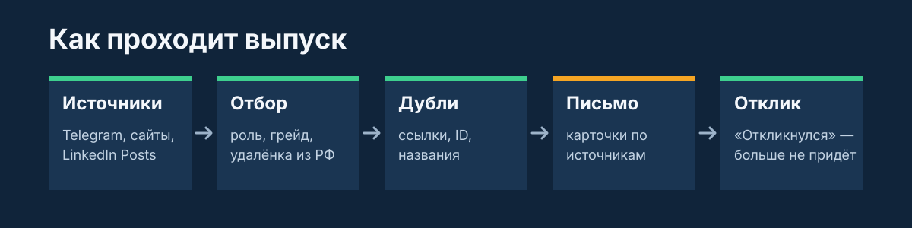

<p align="center">
  
</p>

# Vacancy Digest — автоматизированный поиск и отбор вакансий

**Python-проект для поиска, проверки и отбора вакансий по заданным критериям.** Собирает сведения из нескольких открытых источников, обрабатывает описания, исключает неподходящие позиции и дубли, сохраняет историю и формирует структурированный результат. Использует правила фильтрации; предусмотрен опциональный анализ через локальную LLM.

**Применение как портфолио:** система демонстрирует многоисточниковый поиск, нормализацию данных, отбор по условиям, удаление повторов, хранение истории и формирование итоговых подборок. Эту архитектуру можно адаптировать к поиску кандидатов, но в текущем продукте нет оценки персональных профилей кандидатов, интеграции с hh.ru под аккаунтом заказчика и экспорта в его Excel-шаблон.

**Навигация:** [Как проходит выпуск](#как-проходит-выпуск) · [Быстрый старт](#быстрый-старт) · [LinkedIn Posts](#linkedin-posts-работающая-браузерная-интеграция) · [Что приходит в письме](#что-приходит-в-письме) · [Источники](#источники) · [Установка](#установка-windows-один-раз) · [Команды](#команды) · [Если что-то не так](#если-что-то-не-так)

Дважды в день — утром после включения компьютера и в 17:00 — агент обходит Telegram-каналы и
jabka.work, youngjunior.ru, Хабр Карьеру, Авито, Aviasales, VK, МТС, МегаФон, Сбер, 2ГИС и Магнит Tech
и публикации LinkedIn по хэштегам, отбирает вакансии **продуктового аналитика и аналитика
данных**, которые можно делать **удалённо из России**, убирает дубли и присылает письмо. Вечером —
только то, что появилось после утра. Прямо из письма можно отметить «откликнулся» — такие вакансии
больше не приходят.

**Критерий завершения v1:** 7 дней подряд оба выпуска приходят сами, ни один источник не падает два выпуска подряд,
отметки подхватываются и в каналах не находится подходящих вакансий, которых не было в письме.

## Как проходит выпуск

<p align="center">
  
</p>

1. **Источники.** Telegram-каналы, сайты работодателей и публикации LinkedIn читаются без аккаунтов, кроме LinkedIn.
2. **Отбор.** Остаются вакансии продуктового аналитика и аналитика данных; junior, офис и обязательная релокация отсекаются.
3. **Дубли.** Одна вакансия из нескольких источников даёт одну карточку со всеми ссылками.
4. **Письмо.** Карточки сгруппированы по источникам: зелёные подходят, оранжевые стоит уточнить.
5. **Отметка.** «✓ Откликнулся» в один клик, следующий выпуск такую вакансию не пришлёт.

## Быстрый старт

```
setup.bat                              создать .venv, поставить зависимости, сделать secrets.env
run_digest.bat --dry-run --force       пробный прогон: ничего не отправляется и не запоминается
run_digest.bat --force                 настоящая отправка письма
```

Полная настройка почты, модели и автозапуска — в разделе [«Установка»](#установка-windows-один-раз).

## Документация

| Документ | Что там |
|---|---|
| `README.md` | что это, установка, команды |
| `ARCHITECTURE.md` | как устроено: модули, поток данных, хранилище, отбор, отказоустойчивость |
| `memory.md` | решения и почему, статус, открытые вопросы, журнал сессий |
| `CLAUDE.md` | короткая инструкция для AI-агента в VS Code |
| `architecture-flow.html` | схема одного запуска (открыть в браузере; ссылки на строки кода) |
| `architecture-map.html` / `.json` | карта для человека / для агента: стек, структура, БД, автоматика, «гочи», roadmap |

## LinkedIn Posts: работающая браузерная интеграция

Поиск публикаций LinkedIn уже подключён к утреннему и вечернему запуску: `sources.linkedin_posts.enabled: true`. Это отдельный от почты модуль (`vd/sources/linkedin_posts.py`, `vd/linkedin_browser.py`, `vd/linkedin_bridge.py`), работающий через **видимый Chrome с Playwright**. Для входа используется отдельный браузерный профиль; пользователь входит **вручную**, автоматическая авторизация не предусмотрена. Cookies, профиль и учётные данные в репозиторий не включаются.

**Конвейер:** поиск за последнюю неделю по 14 независимым хэштегам → чтение доступного полного русского текста публикаций → извлечение постоянных ID и ссылок → разделение явно перечисленных вакансий → проверка признаков найма, роли, грейда и формата → исключение закрытых и ранее просмотренных записей → общий дайджест и статистика по каждому тегу. Для фильтрации LinkedIn используется Python; LLM здесь необязательна.

**Хэштеги:** `#hiring`, `#ProductAnalyst`, `#AnalyticsJobs`, `#DataAnalyst`, `#ProductAnalytics`, `#BIAnalyst`, `#продуктовыйаналитик`, `#аналитикданных`, `#vacancy`, `#hr`, `#jobs`, `#вакансия`, `#работа`, `#карьера`.

**Ограничения:** максимум 20 новых карточек и две прокрутки на хэштег; уже виденные посты в лимит не входят, но каждая такая карточка тоже занимает около 3 секунд; не более 75 секунд на тег. Общий бюджет по умолчанию 1000 секунд; на 23.11.2026 разово 1200 секунд. Статистика отмечает частичные результаты и ошибки, поэтому обход всех тегов не означает чтения всех публикаций платформы.

**Верификация (20.11.2026):** dry-run на копии SQLite по трём хэштегам: 36 карточек, из них 29 новых полных публикаций и 7 уже известных; без ошибок копирования и IPC. Полный набор — 295 автоматических тестов. Работа после 23.11 должна отдельно проверяться по штатным журналам и письмам.

Детали: [архитектура](ARCHITECTURE.md) и [проверка браузерной интеграции](docs/handoff-2026-11-20-linkedin-fixes.md).

## Что реализовано

- Сбор вакансий из нескольких открытых Telegram-каналов и карьерных сайтов.
- Проверка названий, условий удалённой работы, требуемой специализации и грейда.
- Обработка описаний и отбор по правилам; при включении — дополнительная проверка локальной LLM через LM Studio.
- Дедупликация между источниками и сохранение истории в SQLite.
- Формирование HTML-письма с источниками, датами и отметками «Откликнулся».
- Запуск по расписанию в Windows, режим предварительного просмотра (`--dry-run`), журналирование и диагностика ошибок.

## Что приходит в письме

Тема — «20.10 утро: 27 подходят, 9 уточнить» / «20.10 вечер: …».

- **LinkedIn Posts** — найденные через браузер публикации с признаками найма; отдельный источник уже включён в этой ветке. Почтовые LinkedIn-уведомления остаются выключенными.
- **Группы по источникам** (jabka.work, TG · careerstation_analyst, …), сначала те, где больше подходящих.
  Внутри — зелёные карточки (**подходят**: нужная роль, можно удалённо из РФ), потом оранжевые
  (**формат не указан** — стоит уточнить). У каждой вакансии сквозной номер.
- **Дата размещения** в каждой карточке: дата из источника, а при её отсутствии — «Дата размещения не указана».
  У ссылок из подборок — «Дата подборки», чтобы не выдавать её за дату самой вакансии. Время постов переводится в МСК.
- **«✓ Откликнулся»** под вакансией и **«☑ Разобрал группу (N)»** под группой — один клик, отметка уходит
  в Google Форму; следующий выпуск её подхватит, подтвердит строкой «Отмечено откликов: …» и эти вакансии
  больше не пришлёт. Таблица ответов формы — читаемый список откликов (код · название · компания).
  В самом письме отметку не видно — письмо после доставки не меняется.
- **Источники** — по каждому: сколько новых постов прочитано и сколько дошло до письма,
  либо «новых постов нет» / «подходящих не найдено».
- Красная плашка, если источник (или таблица отметок) не прочитан — это сбой, а не «спокойный день»;
  жёлтая — если канал прочитан не целиком (новых постов больше лимита страниц) или включённая
  локальная модель была недоступна и отбор шёл по ключевым словам.
- Если запуск упал целиком — приходит короткое письмо «СБОЙ агента» с текстом ошибки.

Вакансии со ссылкой на hh.ru в письмо не попадают — там отклик вручную. Junior и стажёры отсекаются и по
разделам подборок («Junior:», «Подборка Junior/Стажёр …»), в том числе если та же вакансия пришла из другого канала.
Обязательная релокация отсекается даже при удалённой работе на старте; «без релокации» не мешает отбору.

Подборки вида «Подборка актуальных вакансий за неделю» разворачиваются в отдельные вакансии:
уже виденные пропускаются, невиденные посты открываются целиком. Подпись в письме — «из подборки».

Если пост из подборки не открылся или исчерпан лимит чтения, он не считается прочитанным.
Подборка сохраняется в очередь следующего выпуска, включая уже загруженные вложенные подборки.
Очередь обновляется вместе с историей после успешной отправки письма; в письме есть предупреждение.

Дедупликация учитывает ссылку вакансии и точные название/компанию между источниками.
Также распознаёт одну исходную вакансию по конкретной ссылке работодателя с ID: в выпуске остаётся
одна карточка со ссылками на все публикации. Разные известные ID, грейды и команды не склеиваются
по одному названию; отдельные карточки одного сайта сохраняются.
Полные карточки jabka дополняют работодателя, описание и ссылки отклика (до 20 за запуск;
настройка `run.dedup_detail_limit`). Ошибка обогащения сохраняет исходную карточку и даёт предупреждение.

Похожие описания одной компании и направления команды за последние 10 дней получают пометку
«Возможно, уже присылали» со ссылкой, но остаются в письме со своим кодом отметки.
Для такой пометки нужно минимум 12 общих содержательных слов и совпадение не менее половины
слов более короткого описания; общие условия работы исключаются. Это осторожный поиск совпадений,
он не распознаёт все перефразировки. Подтверждённые повторы проверяются за `run.dedup_days` (30 дней),
отмеченные «Откликнулся»/«Разобрано» — независимо от возраста.
SQLite хранит тексты публикаций, связи одной вакансии, историю кодов и предположения;
старые коды и статусы миграция не переписывает. В письме есть отдельные счётчики повторов и наблюдения
первых шести успешных штатных выпусков. После шести выпусков скрытие по смыслу автоматически не включается.
Для временных сетевых ошибок есть до трёх попыток с короткими паузами; ошибки TLS и обычные
403/404 не повторяются. Явные запреты удалёнки и ограничения территории проверяются также поверх ответа LLM.

## Источники

| Источник | Как читаем | В конфиге |
|---|---|---|
| nodatanojobs, careerstation_analyst, codeworkshopru, HR_CATExpert, talentmove_channel, mtsbankcareer, young_june, newdirections, bigtechjobs, myresume_ru, FreeWorkFeed, wntdan | веб-превью `t.me/s/<канал>`, без аккаунта | `sources.telegram.channels` |
| jabka.work | ссылка поиска с фильтрами «Аналитик» + удалёнка, листает страницы выдачи | `sources.sites` |
| youngjunior.ru | разделы /product-analyst/jobs и /data-analyst/jobs; метка junior/intern, «стажировка», «в офис» → отсев | `sources.sites` |
| Хабр Карьера | утром и в 17:00: поиск «аналитик» и «analyst», страницы выдачи и полные описания новых подходящих по названию вакансий | `sources.sites`, `morning_only: false` |
| Авито | утром и в 17:00: полный раздел аналитики данных и описания вакансий | `sources.sites`, `morning_only: false` |
| Aviasales | утром и в 17:00: активные вакансии и все разделы описания | `sources.sites`, `morning_only: false` |
| VK | утром и в 17:00: публичный API по запросам «аналитик» / «analyst», все страницы и описания с датой из источника; только с меткой «Дистанционный» в поле «Формат работы» карточки | `sources.sites`, `morning_only: false` |
| МегаФон | утром и в 17:00: каталог по «аналитик», «analyst», «BI» с полной пагинацией; явная метка удалёнки, дата публикации | `sources.sites`, `morning_only: false` |
| Сбер | утром и в 17:00: публичный поиск аналитиков с фильтром удалёнки; подтверждение графика в описании вакансии | `sources.sites`, `morning_only: false` |
| 2ГИС | утром и в 17:00: публичный каталог удалённых вакансий; подтверждение TELECOMMUTE в карточке | `sources.sites`, `morning_only: false` |
| Магнит Tech | утром и в 17:00: весь каталог magnit.tech, полные описания; явный удалённый формат, архивные и неопубликованные исключаются | `sources.sites`, `morning_only: false` |
| МТС | утром и в 17:00: публичный каталог МТС и компаний экосистемы, поиск по русскому и английскому названию, ISO-дата и описание | `sources.sites`, `morning_only: false` |
| Т-Банк | утром и в 17:00: публичный поисковый POST API, все страницы и описания; только метка «Удаленный» в карточке, без внешних переадресаций | `sources.sites`, `morning_only: false` |
| Альфа-Банк | утром и в 17:00: API job.alfabank.ru, поиск «аналитик» / «analyst» и полные описания; только «Дистанционная работа», без скрытых, внутренних и истёкших карточек | `sources.sites`, `morning_only: false` |
| Точка Банк | утром и в 17:00: каталог hr.tochka.com «IT / Удалённо», карточки с JobPosting; только TELECOMMUTE, дата публикации из карточки | `sources.sites`, `morning_only: false` |
| Островок | утром и в 17:00: каталог career.ostrovok.ru, полные описания; только активные карточки, где в условиях указана удалёнка | `sources.sites`, `morning_only: false` |
| getmatch | утром и в 17:00: открытый API, специализации Product Analytics и Data Analytics & BI, полные описания; удалёнка только по полю формата: remote для России или «весь мир», без исключения России | `sources.sites`, `morning_only: false` |
| GeekJob | утром и в 17:00: JSON-поиск сайта «аналитик» / «analyst» с фильтром «удалённо», описание и дата JobPosting из карточки; архивные исключаются | `sources.sites`, `morning_only: false` |
| LinkedIn Posts | видимый Chrome/Playwright с отдельным профилем и ручным входом; независимые хэштеги, полный русский текст, отбор Python без LLM | `sources.linkedin_posts` |
| LinkedIn Mail | письма-уведомления в почте (подписки на вакансии, посты знакомых) | `sources.linkedin_mail` (выключен) |

Для Т-Банка, Альфа-Банка и Точки доверие TLS дополнено официальным Russian Trusted Root CA только
внутри дайджеста и только для этих трёх сайтов. Проверка сертификатов остаётся включённой;
ничего устанавливать в Windows не требуется. Источник сертификата и срок действия — [vd/certs/README.md](vd/certs/README.md).

Браузерный поиск требует активной сессии Windows и доступного LinkedIn. Первый запуск и восстановление
ручного входа описаны в [инструкции контроллера](tools/linkedin_browser_pilot/README.md).
На 23.11.2026 бюджет поиска LinkedIn разово увеличен до 20 минут для обхода всех 14 тегов
(`sources.linkedin_posts.total_timeout_by_date`). В остальные даты — 1000 секунд;
на тег до 20 карточек и двух прокруток, не более 75 секунд.
Для LinkedIn удалёнка принимается без отдельного разрешения РФ, если нет явного исключающего
ограничения; без формата — «уточнить». Частичная выдача и ошибки тегов отражаются в письме.
Подтверждённые ID/ссылки вакансий и точные публикации подавляются без срока; смысловое сходство
по-прежнему лишь помечается. Новый пост с общим названием должности не считается подтверждённым повтором.

Карьерные сайты при первом обходе берутся за `lookback_days_first_run`: 5 дней для Хабра, Авито и Aviasales,
14 дней для VK, МТС, МегаФона, Сбера, 2ГИС, Т-Банка, Альфа-Банка, Точки и Островка, если известна дата; без даты —
текущие активные вакансии один раз. Далее приходят только новые. Старые карточки первого обхода
запоминаются после успешной отправки письма и на следующий день не возвращаются.
Все включённые источники проверяются утром и в 17:00. `--dry-run` проверяет их в любое время.
Нераспознанная пустая страница считается ошибкой источника; подтверждённая пустая выдача Хабра — успешным чтением.
У Aviasales команда добавляется к должности (например, «Product Analyst — SERP»), чтобы разные команды
с одинаковым названием позиции не терялись при удалении дублей.

## Установка (Windows, один раз)

1. **Python 3.10+** с python.org (галочка «Add to PATH»).
2. В папке проекта запустить **`setup.bat`** — создаст `.venv`, поставит зависимости, сделает `secrets.env` из шаблона.
3. **Почта.** В `config.yaml` → `mail.provider`: `gmail` или `yandex` (ящик, на который зарегистрирован LinkedIn).
   В `secrets.env` — адрес и **пароль приложения**:
   - Gmail: включить двухэтапную проверку → https://myaccount.google.com/apppasswords → создать пароль;
   - Яндекс: Почта → Все настройки → Почтовые программы → включить IMAP и «Пароли приложений»,
     затем Яндекс ID → Безопасность → Пароли приложений → Почта.
4. **LM Studio.** Загрузить модель, её идентификатор (вкладка Developer) вписать в `config.yaml` → `llm.model`.
   Один раз выполнить `%USERPROFILE%\.lmstudio\bin\lms.exe bootstrap` — тогда скрипт сам поднимает сервер.
5. **Пробный прогон без отправки:** `run_digest.bat --dry-run --force` → открыть `out\digest_ГГГГ-ММ-ДД.html`, лог в `logs\run.log`.
6. **Настоящая отправка:** `run_digest.bat --force` → письмо должно прийти.
7. **Автозапуск:** правый клик по `register_task.ps1` → «Выполнить с помощью PowerShell».
   Два выпуска в день: утренний — через 10 минут после входа в Windows (успевает подключиться VPN), вечерний — в 17:00
   (компьютер выключен в 17:00 — при включении). Каждый выпуск не чаще раза, вечером — только новое после утра.
   Только в рабочие дни производственного календаря РФ (с переносами; isdayoff.ru, кэш `data/calendar-<год>.txt`):
   в выходные и праздники писем нет, всё новое придёт в первый рабочий день. `--force` / `--dry-run` — в любой день.
8. **Отметки «Откликнулся»** (по желанию; без них `marks.enabled: false`). Google Форма с одним
   вопросом-строкой `id`, без сбора почты и без «одного ответа» → **Опубликовать** (новые формы — черновики,
   ответы не принимают) → «Ответы» → «Связать с Таблицами». Таблице дать доступ «все, у кого есть ссылка —
   просмотр». В `config.yaml → marks`: `form_url` (…/formResponse), `form_field` (`entry.N` из ссылки
   «⋮ → Получить ссылку для предварительного заполнения»), `sheet_csv_url` (…/export?format=csv).

## Команды

```
run_digest.bat                          обычный запуск
run_digest.bat --dry-run --force        собрать и показать, ничего не отправлять и не запоминать
run_digest.bat --force                  отправить повторно (в текущий выпуск)
run_digest.bat --no-llm                 без модели, по ключевым словам
.venv\Scripts\python main.py --stats    что дал каждый источник за 30 дней и сколько откликов / разобрано
.venv\Scripts\python -m unittest discover -s tests -t .    тесты
```

## Git

`secrets.env`, `data/`, `logs/`, `out/`, `.venv/` в `.gitignore` — пароль и состояние в репозиторий не попадают.
Перед коммитом — тесты.

## Если что-то не так

- Письма нет → `logs\run.log`, `logs\scheduler.log`; статусы запусков — таблица `runs` в `data\state.sqlite`.
- При ошибке отправки дайджеста агент один раз отправляет отдельное письмо «СБОЙ отправки дайджеста»:
  время запуска, выпуск, причина и путь сохранённой подборки. История вакансий не продвигается.
  Если SMTP недоступен и для извещения, обе ошибки остаются в логе; доставка извещения не гарантируется.
- SMTP `server response timeout` после передачи письма: файл для curl должен иметь окончания строк CRLF
  (`email.policy.SMTP`). На Яндексе LF воспроизводил зависание после DATA/354; CRLF принят на том же порту 465.
  Разбор и результаты сравнения: `docs/smtp-timeout-2026-11-16.md`.
- «Telegram: не прочитан ни один из N каналов — соединение обрывается» → провайдер блокирует t.me, запросы скрипта
  должны идти через VPN. Browsec Desktop в «умном» режиме пускает через VPN только выбранные программы — добавить в его
  список приложений `C:\Users\w-w3\AppData\Local\Programs\Python\Python311\python.exe` (именно он ходит в сеть; venv-овский
  `.venv\Scripts\python.exe` — лишь запускатель) и на всякий случай `.venv\Scripts\python.exe`.
  Проверка: `.venv\Scripts\python -c "import requests; print(requests.get('https://t.me/s/nodatanojobs', timeout=15).status_code)"` → 200.
- Через Browsec почтовые порты закрыты, поэтому письмо отправляет системный `C:\Windows\System32\curl.exe` (его нет
  в списке программ VPN — идёт напрямую). Если письма перестали уходить — проверить, что curl.exe не добавлен в Browsec.
- «Почта не приняла логин/пароль приложения» → пересоздать пароль приложения; для Яндекса проверить, что включён IMAP.
- Источник «не прочитан» несколько дней подряд → открыть его ссылку в браузере: могла смениться вёрстка.
- Начать с чистого листа → удалить `data\state.sqlite` (первый запуск возьмёт посты за 3 дня).
